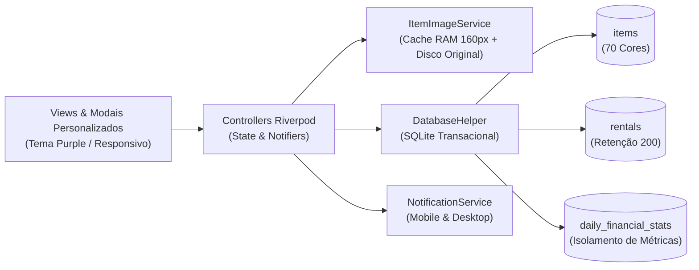

<div align="center">


<br />

[](#)
[](https://flutter.dev)
[](https://riverpod.dev)
[](https://www.sqlite.org)
[](#)

**Versão experimental do AlugPlus+ com novo tema Purple, paleta estendida de 70 cores, motor de imagens em RAM e ferramentas inovadoras de gestão em tempo real.**

[Visão Geral](#-visão-geral-e-identidade-purple) •
[Funcionalidades Experimentais](#-laboratório-de-funcionalidades-experimentais) •
[Catálogo de 70 Cores](#-paleta-expandida-de-70-cores) •
[Regras de Negócio](#-regras-de-negócio-e-motor-de-tempo) •
[Arquitetura](#-arquitetura-e-banco-de-dados) •
[Como Executar](#-como-executar-e-compilar)

</div>

---

## 🔮 Visão Geral e Identidade Purple

A branch **Purple** do **AlugPlus+** é o laboratório de inovação e recursos experimentais do ecossistema. Abandonando a identidade corporativa azul padrão, esta edição adota uma temática **Roxo/Púrpura de Alto Contraste** (`#7C3AED` / `#5B21B6` / `#A78BFA`) sobre superfícies noturnas profundas (`#0F172A` / `#1E293B`).

Projetado especificamente para operadores que buscam **máxima fluidez visual**, testes de novas interfaces e recursos avançados de controle de locação de bicicletas, patinetes e carrinhos.

<div align="center">


</div>

---

## 🧪 Laboratório de Funcionalidades Experimentais

Esta versão traz adições exclusivas desenvolvidas e testadas diretamente na branch **Purple**:

| Módulo Experimental | Descrição Técnica & Benefício Operacional |
| :--- | :--- |
| **🟣 Tema Roxo Vibrante (Purple Edition)** | Redefinição completa dos tokens do `ThemeData`, gradientes de botões de ação flutuante (`FloatingActionButton`), AppBar e insígnia estilizada de raio em tons de violeta e ametista. |
| **🎨 Mega Paleta de 70 Cores** | Expansão do catálogo de 30 para **70 cores hexadecimais exclusivas** categorizadas (roxos, violetas, fúcsias, esmeraldas, cianos, âmbares e safiras). |
| **🖼️ Pipeline de Imagens & Otimização de RAM** | Armazenamento de fotos originais em resolução total em disco, enquanto a memória RAM processa e mantém apenas **miniaturas leves de 160px**, zerando travamentos e consumo de memória. |
| **🔍 Janela Flutuante com Super Zoom (4.5x)** | Ao tocar na foto de qualquer item (Catálogo, Histórico ou Aluguel Ativo), abre-se um modal flutuante com fundo desfocado (`BackdropFilter`) e zoom interativo por pinça ou toque duplo. |
| **⏱️ Gatilho de Acréscimo Parametrizável** | Ajuste flexível do minuto exato de início de acréscimo (`3 min`, `4 min`, `5 min`, etc.) direto na aba de Configurações, com recálculo dinâmico nos cronômetros. |
| **📱 Exportador Direto para WhatsApp** | Botão de 1 toque no Controle de Aluguéis que copia todo o lote de saídas, chegadas e valores pagos já formatados para envio imediato ao WhatsApp corporativo. |
| **🗑️ Expurgo Financeiro Atômico** | Botão individual de exclusão no Histórico que apaga o aluguel e desconta automaticamente seu valor e contagem de `daily_financial_stats` sem deixar rastros. |

---

## 🎨 Paleta Expandida de 70 Cores

O catálogo de equipamentos agora conta com **70 cores hexadecimais** distintas para personalização ilimitada da frota:

```text
[ 30 Cores Clássicas ]
#E53935  #D81B60  #8E24AA  #5E35B1  #3949AB  #1E88E5  #039BE5  #00ACC1  #00897B  #43A047
#7CB342  #C0CA33  #FDD835  #FFB300  #FB8C00  #F4511E  #6D4C41  #757575  #546E7A  #B71C1C
#880E4F  #4A148C  #311B92  #0D47A1  #006064  #1B5E20  #33691E  #E65100  #BF360C  #263238

[ 40 Novas Cores - Purple Edition ]
• Violetas & Púrpuras: #7C3AED  #6D28D9  #9333EA  #A855F7  #C084FC  #4C1D95  #6B21A8  #A21CAF  #C026D3  #E879F9
• Rosas & Carmins:     #EC4899  #DB2777  #BE185D  #F43F5E  #E11D48
• Laranjas & Âmbares:  #F97316  #EA580C  #D97706  #F59E0B  #CA8A04
• Amarelos & Limas:    #EAB308  #84CC16  #65A30D  #4D7C0F
• Verdes & Teals:      #10B981  #059669  #047857  #14B8A6  #0D9488  #0F766E
• Cianos & Celestes:   #06B6D4  #0891B2  #0284C7  #0EA5E9  #38BDF8
• Azuis & Índigos:     #2563EB  #1D4ED8  #1E40AF  #6366F1  #4F46E5
```

---

## ⚡ Regras de Negócio e Motor de Tempo

### 1. Cronômetro Reativo de Alta Precisão
A cada segundo (`Timer.periodic`), o motor central recalcula o progresso de cada locação:

$$\text{Progresso} = \text{clamp}\left(\frac{t_{\text{atual}} - t_{\text{início}}}{t_{\text{previsto}} - t_{\text{início}}}, 0.0, 1.0\right)$$

* **Em andamento:** A barra de progresso adota a cor própria do item cadastrado.
* **Tempo esgotado ($t_{\text{atual}} \ge t_{\text{previsto}}$):** A barra trava em vermelho vivo, atinge `100%` e emite **notificação local imediata**.

### 2. Tolerância e Acréscimo Configuráveis
* **Gatilho Personalizado:** O operador escolhe em qual minuto de atraso o acréscimo se inicia (padrão: 4º minuto, tolerância de 3 minutos).
* **Cálculo da Taxa de Atraso:**
$$\text{Acréscimo} = \text{R\$ } 1,00 + \max\left(0, \text{minutos de atraso} - \text{minuto configurado}\right) \times \text{R\$ } 1,00$$
* Notificação nativa específica disparada no minuto exato do início da cobrança.

---

## 🏗️ Arquitetura e Banco de Dados



---

## 🚀 Como Executar e Compilar

### 1. Selecionar a branch Purple
```bash
git checkout Purple
git pull origin Purple
flutter pub get
```

### 2. Executar no seu dispositivo
```bash
# Execução direta com recarga rápida
flutter run
```

### 3. Validar testes automatizados
```bash
flutter analyze
flutter test
```

### 4. Compilar o APK Release
```bash
flutter build apk --release
```
O pacote final estará disponível em: `build/app/outputs/flutter-apk/app-release.apk`

---

<div align="center">
  <sub>AlugPlus+ <b>Purple Edition</b> • Criado para operadores ágeis com 💜 em Flutter</sub>
</div>
