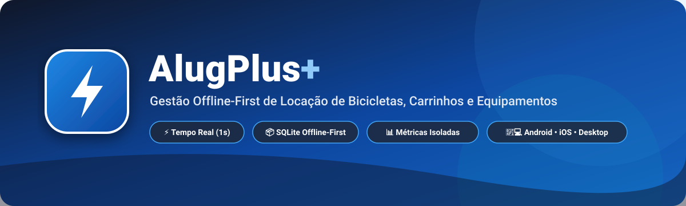
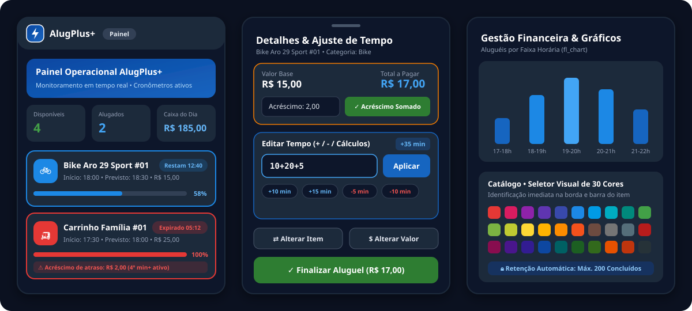
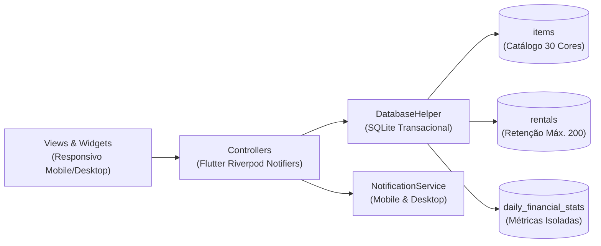

<div align="center">



<br />

[](https://flutter.dev)
[](https://dart.dev)
[](https://riverpod.dev)
[](https://www.sqlite.org)
[](#)

**Sistema profissional e offline-first para gestão de locação de bicicletas, carrinhos e equipamentos recreativos em tempo real.**

[Visão Geral](#-visão-geral-e-interface) •
[Funcionalidades](#-principais-funcionalidades) •
[Regras de Negócio](#-regras-de-negócio-e-inteligência-de-tempo) •
[Arquitetura](#-arquitetura-e-banco-de-dados) •
[Como Executar](#-como-executar-e-compilar)

</div>

---

## 🖥️ Visão Geral e Interface

O **AlugPlus+** foi projetado para operadores de locação que precisam de **velocidade, precisão no controle de tempo e confiabilidade total sem depender de internet**. Com tema escuro nativo de alto contraste (`#0F172A` / `#1E293B`) e assinatura visual em azul (`#1565C0` / `#0D47A1`), o aplicativo se adapta automaticamente entre celulares (`NavigationBar`) e computadores/tablets (`NavigationRail`).

<div align="center">



</div>

---

## ✨ Principais Funcionalidades

| Módulo | Recursos em Destaque |
| :--- | :--- |
| **📊 Painel (Dashboard)** | • KPIs em tempo real: **Itens Disponíveis**, **Alugados Agora** e **Faturamento do Dia**.<br>• Monitoramento ao vivo dos aluguéis ativos com barras de progresso coloridas.<br>• Botão de ação rápida (`+ Novo Aluguel`) para lançamentos individuais ou em lote. |
| **⏱️ Controle de Aluguéis** | • **Cronômetro de 1 segundo:** Barra de progresso na cor do item que muda para vermelho ao atingir `100%` (travada em 100%).<br>• **Calculadora Didática de Tempo:** Adicione ou reduza minutos usando expressões como `15`, `-10` ou `10+20+5`.<br>• **Troca de Equipamento & Valor:** Modais modernos com cores de destaque e preview instantâneo.<br>• **Histórico Inteligente:** Limite automático de 200 registros concluídos para manter o banco ultraleve. |
| **🚲 Catálogo de Itens** | • Filtro rápido entre **"Apenas itens comigo / ativos"** e **"Todos"**.<br>• Seletor visual em grade com **30 cores hexadecimais exclusivas**.<br>• Suporte a foto do equipamento via Galeria (`image_picker`) ou URL Web. |
| **💰 Gestão Financeira** | • **Isolamento de Métricas (`daily_financial_stats`):** O faturamento jamais é perdido mesmo ao limpar o histórico de aluguéis.<br>• Gráfico de barras por faixa horária (`17-18h`, `18-19h`, etc.) e gráfico de pizza por categoria (`fl_chart`).<br>• Fechamento de turno (**Resetar / Fechar Dia**) e opção para limpar fechamentos antigos. |
| **⚙️ Configurações** | • Preço padrão e tempo padrão configuráveis por categoria (`Bike`, `Carrinho`, `Outro`).<br>• Alternância instantânea entre **Modo Escuro (`#0F172A`)** e **Modo Claro (`#F8FAFC`)**.<br>• **Zona de Manutenção:** Restauração completa de fábrica com confirmação de segurança. |

---

## ⚡ Regras de Negócio e Inteligência de Tempo

### 1. Cronômetro & Barra de Progresso
A cada **1 segundo**, o motor central recalcula o progresso de todas as locações ativas:

$$\text{Progresso} = \text{clamp}\left(\frac{t_{\text{atual}} - t_{\text{início}}}{t_{\text{previsto}} - t_{\text{início}}}, 0.0, 1.0\right)$$

* **Dentro do prazo:** A barra de progresso exibe a cor configurada no equipamento e o percentual avança até `100%`.
* **Tempo esgotado ($t_{\text{atual}} \ge t_{\text{previsto}}$):** A barra fica **vermelha** imediatamente, trava em `100%` e dispara uma **notificação nativa no sistema operacional** (Android, iOS, Windows ou Linux).

### 2. Cálculo Automático de Acréscimo (Surcharge)
* **Tolerância de 3 minutos** após o horário previsto de devolução.
* A partir do **4º minuto exato de atraso**, dispara-se uma nova notificação nativa e inicia-se o cálculo automático:

$$\text{Acréscimo} = \text{R\$ } 1,00 + (\text{minutos completos adicionais além do 4º} \times \text{R\$ } 1,00)$$

* O operador pode editar manualmente o valor do acréscimo e escolher se deseja somá-lo ao valor final através do botão **"Adicionar Acréscimo ao Valor"**.

---

## 🏗️ Arquitetura e Banco de Dados

O projeto segue uma arquitetura modular baseada em *Features* com estado imutável gerenciado pelo **Riverpod**:



### Estrutura de Pastas

```text
lib/
├── core/
│   ├── constants/       # Paleta de 30 cores (app_colors.dart) e Temas Dark/Light (app_theme.dart)
│   ├── database/        # SQLite helper transacional, FFI Desktop, triggers e seeds (migrations.dart)
│   ├── services/        # Abstração unificada de notificações nativas (notification_service.dart)
│   └── utils/           # Formatadores BRL/datas e avaliador aritmético de tempo (time_utils.dart)
├── features/
│   ├── catalog/         # CRUD de equipamentos, filtro de ativos e seletor de 30 cores
│   ├── dashboard/       # Painel operacional com KPIs e listagem em tempo real
│   ├── financial/       # Gráficos fl_chart, fechamento de expediente e histórico diário
│   ├── rentals/         # Lançamento em lote, cronômetro central, detalhes e calculadora de tempo
│   └── settings/        # Presets por categoria, tema e restauração de fábrica
├── shared/
│   └── widgets/         # Casca responsiva NavigationBar / NavigationRail e Logo estilizada
└── main.dart            # Inicialização multiplataforma (Mobile + Desktop FFI)
```

---

## 🚀 Como Executar e Compilar

### 1. Clonar e instalar dependências
```bash
git clone https://github.com/SEU-USUARIO/alugplus.git
cd alugplus
flutter pub get
```

### 2. Executar em modo de desenvolvimento
```bash
# Linux / Windows / Android / iOS
flutter run
```

### 3. Executar os testes automatizados
```bash
flutter analyze
flutter test
```

### 4. Gerar APK de Produção (Android)
```bash
flutter build apk --release
```
O instalador final será gerado em:
`build/app/outputs/flutter-apk/app-release.apk`

---

<div align="center">
  <sub>Desenvolvido com ❤️ em Flutter • <b>AlugPlus+</b></sub>
</div>
