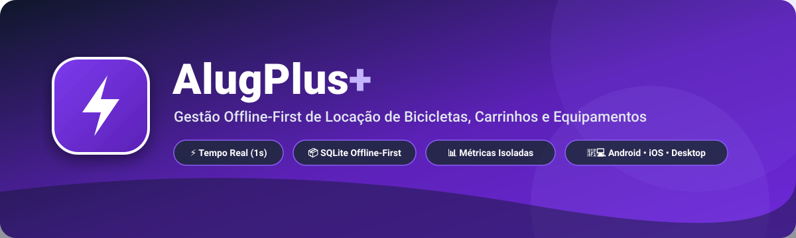
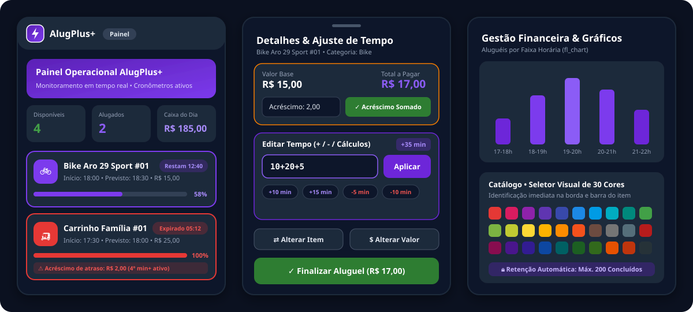
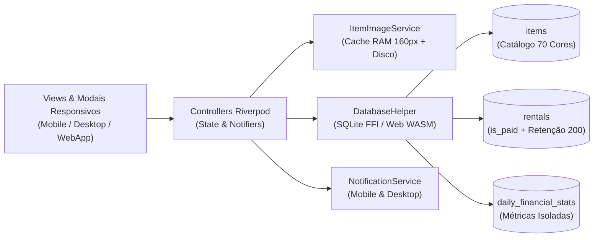

<div align="center">



<br />

[](#)
[](https://flutter.dev)
[](https://dart.dev)
[](https://riverpod.dev)
[](https://www.sqlite.org)
[](#)

**Sistema profissional e offline-first para gestão de locação de bicicletas, carrinhos e equipamentos recreativos em tempo real — agora com WebApp (PWA), controle de status de pagamento e paleta de 70 cores.**

[Visão Geral](#-visão-geral-e-interface) •
[Funcionalidades](#-principais-funcionalidades) •
[WebApp & iPhone](#-sistema-webapp-pwa-e-versão-iphone) •
[Regras de Negócio](#-regras-de-negócio-e-inteligência-de-tempo) •
[Arquitetura](#-arquitetura-e-banco-de-dados) •
[Como Executar](#-como-executar-e-compilar)

</div>

---

## 🖥️ Visão Geral e Interface

O **AlugPlus+** foi projetado para operadores de locação que precisam de **velocidade, precisão no controle de tempo e confiabilidade total sem depender de internet**. Com tema escuro nativo de alto contraste (`#0F172A` / `#1E293B`) e assinatura visual em azul (`#1565C0` / `#0D47A1`), o aplicativo se adapta automaticamente entre celulares (`NavigationBar`), navegadores Web/PWA e computadores/tablets (`NavigationRail`).

<div align="center">



</div>

---

## ✨ Principais Funcionalidades

| Módulo | Recursos em Destaque |
| :--- | :--- |
| **📊 Painel (Dashboard)** | • KPIs em tempo real: **Itens Disponíveis**, **Alugados Agora** e **Faturamento do Dia**.<br>• Monitoramento ao vivo dos aluguéis ativos com barras de progresso coloridas e **indicador visual de pagamento (`Pago`)**.<br>• Botão de ação rápida (`+ Novo Aluguel`) para lançamentos individuais ou em lote. |
| **⏱️ Controle de Aluguéis** | • **Verificação de Pagamento (`Pago` / `Não Pago`):** Botão/switch dedicado na tela de detalhes do aluguel e badge de status no card para confirmar rapidamente se o aluguel já foi pago.<br>• **Cronômetro de 1 segundo:** Barra de progresso na cor do item que muda para vermelho ao atingir `100%` (travada em 100%).<br>• **Calculadora Didática de Tempo:** Adicione ou reduza minutos usando expressões como `15`, `-10` ou `10+20+5`.<br>• **Exportador Direto para WhatsApp:** Botão de 1 toque para copiar o lote de saídas, chegadas e valores pagos formatados para envio imediato.<br>• **Troca de Equipamento & Valor:** Modais modernos com cores de destaque e preview instantâneo.<br>• **Histórico Inteligente & Expurgo Atômico:** Limite automático de 200 registros concluídos e exclusão individual que desconta o valor de `daily_financial_stats` automaticamente. |
| **🚲 Catálogo de Itens** | • Filtro rápido entre **"Apenas itens comigo / ativos"** e **"Todos"**.<br>• Seletor visual em grade com **70 cores hexadecimais exclusivas** (30 clássicas + 40 novas tonalidades).<br>• **Pipeline de Imagens & Super Zoom (4.5x):** Armazenamento original em disco com cache leve em RAM (`160px`) e modal flutuante com zoom por pinça/toque duplo.<br>• Suporte a foto do equipamento via Galeria (`image_picker`) ou URL Web. |
| **💰 Gestão Financeira** | • **Isolamento de Métricas (`daily_financial_stats`):** O faturamento jamais é perdido mesmo ao limpar o histórico de aluguéis.<br>• Gráfico de barras por faixa horária (`17-18h`, `18-19h`, etc.) e gráfico de pizza por categoria (`fl_chart`).<br>• Fechamento de turno (**Resetar / Fechar Dia**) e opção para limpar fechamentos antigos. |
| **⚙️ Configurações** | • Preço padrão, tempo padrão e **gatilho de acréscimo parametrizável** por minuto de atraso.<br>• Alternância instantânea entre **Modo Escuro (`#0F172A`)** e **Modo Claro (`#F8FAFC`)**.<br>• **Zona de Manutenção:** Restauração completa de fábrica com confirmação de segurança. |

---

## 🌐 Sistema WebApp (PWA) e Versão iPhone

A versão **1.50** introduz suporte completo para execução em navegadores como aplicativo instalável (**PWA**):

* **Flutter Web + SQLite WASM (`web/`):** Persistência local diretamente no navegador via `sqflite_common_ffi_web` e `sqlite3.wasm`, com manifesto PWA (`web/manifest.json`) e ícones dedicados em azul AlugPlus+.
* **Versão Standalone para iPhone (`AlugPlus_iPhone.html`):** Arquivo HTML único e autossuficiente otimizado para Safari no iOS, permitindo abrir e instalar na Tela de Início mesmo offline, mantendo a mesma identidade visual azul e regras de negócio.

---

## ⚡ Regras de Negócio e Inteligência de Tempo

### 1. Cronômetro & Barra de Progresso
A cada **1 segundo**, o motor central recalcula o progresso de todas as locações ativas:

$$\text{Progresso} = \text{clamp}\left(\frac{t_{\text{atual}} - t_{\text{início}}}{t_{\text{previsto}} - t_{\text{início}}}, 0.0, 1.0\right)$$

* **Dentro do prazo:** A barra de progresso exibe a cor configurada no equipamento e o percentual avança até `100%`.
* **Tempo esgotado ($t_{\text{atual}} \ge t_{\text{previsto}}$):** A barra fica **vermelha** imediatamente, trava em `100%` e dispara uma **notificação nativa no sistema operacional** (Android, iOS, Windows ou Linux).

### 2. Tolerância e Acréscimo Configuráveis
* **Gatilho Personalizado:** O operador pode configurar nas Configurações em qual minuto de atraso o acréscimo se inicia (padrão: **4º minuto**, com tolerância de 3 minutos).
* **Cálculo da Taxa de Atraso:**

$$\text{Acréscimo} = \text{R\$ } 1,00 + \max\left(0, \text{minutos de atraso} - \text{minuto configurado}\right) \times \text{R\$ } 1,00$$

* O operador também pode editar manualmente o valor do acréscimo e escolher se deseja somá-lo ao valor final através do botão **"Adicionar Acréscimo ao Valor"**.

---

## 🏗️ Arquitetura e Banco de Dados

O projeto segue uma arquitetura modular baseada em *Features* com estado imutável gerenciado pelo **Riverpod**:



### Estrutura de Pastas

```text
├── AlugPlus_iPhone.html     # WebApp standalone offline otimizado para iOS/Safari
├── web/                     # Manifesto PWA, ícones, index.html, sqflite_sw.js e sqlite3.wasm
└── lib/
    ├── core/
    │   ├── constants/       # Paleta de 70 cores (app_colors.dart) e Temas Dark/Light (app_theme.dart)
    │   ├── database/        # SQLite helper transacional, FFI Desktop, Web WASM e migrations (v3)
    │   ├── services/        # Notificações nativas e ItemImageService (cache RAM + disco)
    │   └── utils/           # Formatadores BRL/datas e avaliador aritmético de tempo (time_utils.dart)
    ├── features/
    │   ├── catalog/         # CRUD de equipamentos, filtro de ativos e seletor de 70 cores
    │   ├── dashboard/       # Painel operacional com KPIs e listagem em tempo real
    │   ├── financial/       # Gráficos fl_chart, fechamento de expediente e histórico diário
    │   ├── rentals/         # Lançamento em lote, status Pago/Não Pago, WhatsApp, cronômetro e detalhes
    │   └── settings/        # Presets por categoria, gatilho de acréscimo, tema e restauração
    ├── shared/
    │   └── widgets/         # Casca responsiva NavigationBar/NavigationRail, Logo e Preview Zoom 4.5x
    └── main.dart            # Inicialização multiplataforma (Mobile + Desktop FFI + Web WASM)
```

---

## 🚀 Como Executar e Compilar

### 1. Clonar e instalar dependências
```bash
git clone https://github.com/SEU-USUARIO/alugplus.git
cd alugplus
flutter pub get
```

### 2. Executar em modo de desenvolvimento
```bash
# Mobile / Desktop (Linux / Windows / Android / iOS)
flutter run

# WebApp (Chrome / Edge)
flutter run -d chrome
```

### 3. Executar os testes automatizados
```bash
flutter analyze
flutter test
```

### 4. Compilar para Produção (Android & WebApp)
```bash
# APK Android
flutter build apk --release

# WebApp (PWA)
flutter build web --release
```
O instalador Android será gerado em `build/app/outputs/flutter-apk/app-release.apk` e os arquivos estáticos do WebApp em `build/web/`.

---

<div align="center">
  <sub>Desenvolvido com ❤️ em Flutter • <b>AlugPlus+ v1.50</b></sub>
</div>
